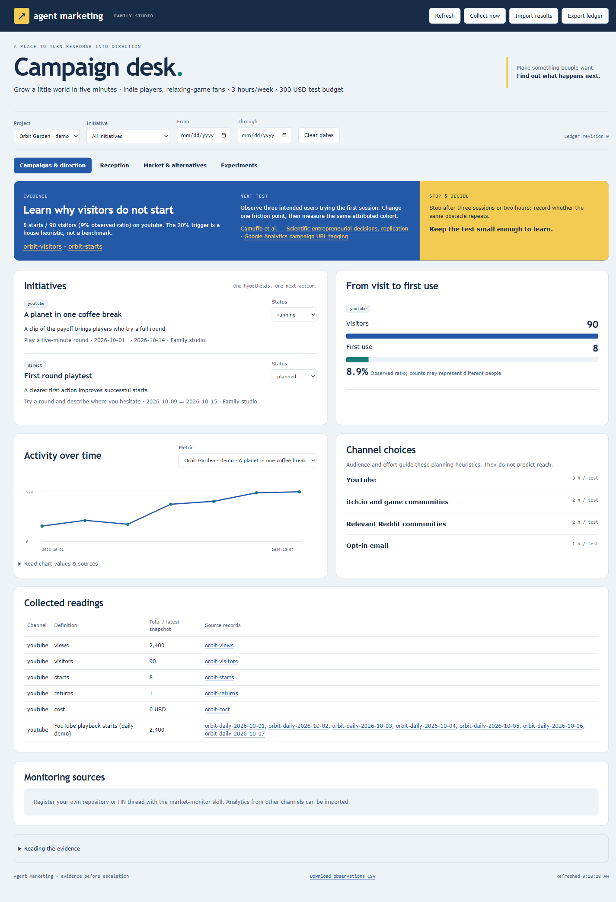

# agent-marketing

An evidence-led marketing plugin for the tools, apps, games and projects your family makes with AI. It helps an agent choose an audience and channels, research alternatives, plan campaigns and collateral, collect results, inspect reception, and decide what to try next.

The local campaign desk connects each recommendation to a source. It shows activity, attributed first-use paths, reviewed reactions, viability evidence, alternatives and experiment uncertainty. CLI and UI share one portable JSON ledger. No account subscription or runtime npm dependency is required.



## Install the plugin

In Claude Code, add the [Hartye marketplace](https://github.com/ehartye/hartye-claude-plugins), then install:

```text
/plugin marketplace add ehartye/hartye-claude-plugins
/plugin install agent-marketing@hartye-plugins
/agent-marketing:market-setup
```

Node 24+ is required. `market-setup` installs a verified runtime outside the plugin cache. After a plugin update the launcher refreshes the runtime itself on first use, so you do not need to run it again; run `market-setup` to check or repair explicitly. See the [releases](https://github.com/ehartye/agent-marketing/releases) for what changed in each version.

## Use it

Ask Claude for the work, and the skills run the CLI for you: `market-discover` and `market-strategy` to choose an audience and channels, `market-campaign` to plan a test, `market-research` to save a sourced report you can read in the desk (Research fit), `market-monitor` to collect or import results and open the local campaign desk, `market-insights` and `market-experiment` to decide what to do next. The skills use a real workspace file you name, and keep synthetic demo data in a separate one. Research that belongs to no project, such as a market analysis, goes in the studio workspace (`--studio`), a fixed place under `~/.agent-marketing/studio/` that updates never touch. The desk opens at `http://127.0.0.1:4318`.

## From a source checkout

This section is for working on the plugin itself or trying it without installing. Plugin users can skip it.

Node 24+:

```powershell
node scripts/setup.mjs
node scripts/run-managed.mjs demo --workspace .agent-marketing/demo.json
node scripts/run-managed.mjs serve --workspace .agent-marketing/demo.json
```

Open `http://127.0.0.1:4318`. Demo metrics are synthetic. Use a different file for a real studio:

```powershell
node scripts/run-managed.mjs init --workspace .agent-marketing/workspace.json
node scripts/run-managed.mjs help
```

Setup installs a content-verified runtime under `~/.agent-marketing/releases/` and writes a receipt. The launcher checks it against the source; rerun setup after updates. `AGENT_MARKETING_HOME` can relocate the install. Existing init/demo files are preserved.

## Skills

| Skill | Outcome |
|---|---|
| market-setup | Install/check the managed runtime |
| market-discover | Audience, value, readiness gates and evidence brief |
| market-strategy | Channel choice with effort, risk and maintenance tradeoffs for the project's stage, sequenced behind gates and checked against the weekly hours |
| market-research | Paying demand, underserved/language markets, alternatives and a sourced decision report |
| market-campaign | Testable campaign, CTA, tagged links, hours, dependencies and review plan |
| market-collateral | Actual reviewable copy, demo/asset brief or creator kit, including store-page assets and trailers for a game |
| market-monitor | Supported API collection, export imports, local desk and what to read when a game has no analytics |
| market-insights | Reach/reception/viability review and a bounded next action |
| market-experiment | Experiment design, counts, uncertainty and stop review |
| market-desk | Keep decisions, next steps, gate checks, documents and collateral picks in the ledger under an initiative, so Needs you now is true |

The `.claude-plugin` manifest follows the sibling agent projects. The plugin is listed in hartye-plugins; this repository can also be loaded as a local plugin in a compatible host. The skills use relative resources and the absolute managed launcher. The skill entry points use portable Agent Skills metadata; retain the repository layout and shared resources when loading them. Optional agent-vids/prose/sprites/beeps integrations are advisory and do not affect core operation.

## What the tools do

`init`, `demo`, `validate`, `import`, `put`, `document`, `report`, `advise`, `plan`, `next`, `decide`, `defer`, `action`, `gate`, `update`, `asset`, `channels`, `experiment`, `utm`, `monitor`, `serve`, `export`, `rules`, `help`. See the [complete CLI and record contract](docs/CLI.md), [example ledger](examples/studio.json) and [CSV example](examples/observations.csv).

Strategy and campaign skills save their full Markdown briefs inside the workspace: strategy on the project, campaign brief on each initiative. Reopen or download them in **Decide & plan**, or use `document show/export`. Full JSON backups include these documents. Existing ledgers remain readable; external assets and document history are not bundled. `validate`, `put` and `import` warn about a field no record defines, suggesting the intended name for a typo, and `--strict` turns those warnings into errors.

A launch that waits on things (a name decision, a truth sheet, a pinned build, an outside playtest, store assets) can say so. A `gates` record is a pass condition with a status (open, passed, failed or waived), an initiative lists the gates and initiatives it waits on in `dependsOn` and its planned maker-hours in `hours`, and `plan <project-id>` reports what is blocked and by what, the hours each calendar week carries against the project's weekly cap, and the budget roll-up. `advise` mentions blocked work and over-cap weeks when they exist, and the desk shows the same under **Decide & plan**. The demo workspace includes a small gated game launch, Lantern Harbor. See [gates, dependencies and weekly hours](docs/CLI.md#gates-dependencies-and-weekly-hours).

The ledger also keeps what the owner has to decide and do. A `decisions` record is a question with options that each state their time, risk, complexity, best practice and maintainability, a recommendation and a default if nobody answers; `actions` are the owner's and the agent's next steps; `updates` is the progress log; an initiative can have a parent and a status note, and a gate a due date and the hours it takes. `marketing next` prints what needs the owner now, most urgent first, and `decide`, `defer`, `action`, `gate set` and `update add` record the answers and log them in the same write. See [decisions, actions and progress](docs/CLI.md#decisions-actions-and-progress) and [what needs the owner now](docs/CLI.md#what-needs-the-owner-now). A write by this release adds three empty collections that an older release refuses, so update every machine that shares a ledger first. In the desk, **Decide & plan** now opens with **Needs you now** (overdue and due-soon decisions, owner actions, gates, collateral waiting for a pick), with decision cards that compare every option on time, risk, complexity, best practice and maintainability and let the owner decide or defer there; below it are the actions, a timeline of what changed, and the initiatives as a tree with progress and the documents, decisions and collateral that belong to each. The **Collateral** tab keeps capsule art, banners, thumbnails, trailers and copy variants in slots: add candidates by upload, link or text, compare them side by side at pixel size, pick one with a reason, and reject the rest with a reason. The rejects stay for reference, and the pick is recorded as a decision. Files are copied beside the ledger, never deleted, and served only from there.

Collateral is tracked the same way. An `assetSlots` record is a place a piece goes (a Steam capsule, a trailer, a store blurb) and `assets` are its candidates: an image, video, PDF or text file copied beside the workspace, an https link such as an artifact, or short copy. `asset pick` selects one, records the choice as a decision with the reason, and keeps the others, rejected ones included, for reference. See [collateral](docs/CLI.md#collateral-slots-candidates-and-picks). The first write by this release adds two more empty collections, so the warning about older releases applies again.

`advise` and `channels` read the project's stage, so an idea, a prototype, a beta and a launched project no longer get the same advice. An idea checks the promise and listens before it posts; a prototype gets intended strangers to a first session; a beta widens through the channel with the best observed ratio; a launched project reads who returns and what players say. For a game, a free web release comes before a paid store page and the store page waits for its readiness gates. Every action names the rules it rests on (`ruleIds`), and `marketing rules stage` and `marketing rules games` print them with their provenance. See [stage-aware advice and channels](docs/CLI.md#stage-aware-advice-and-channels).

Monitoring reads public GitHub stars, optional repository traffic with an appropriately scoped `GITHUB_TOKEN`, and public HN threads through official APIs. Other platform results use authorized JSON/CSV exports normalized to the documented observation schema. Collection errors preserve previous readings; repeated snapshots do not inflate totals. Monitoring is one-shot; an owner-chosen scheduler can call it periodically. No social posting, outreach, ad spending or scheduler is installed.

## Marketing craft

[Craft guides](craft/GUIDE.md), [queryable rules](craft/rules.json), [channel cards](library/channels.json) and [dated research references](craft/REFERENCES.md) cover discovery, positioning, competition, campaigns, collateral, measurement, reception and experiments. They separate research findings from planning heuristics and explain transfer limits. The channel cards cover social, store and community channels as well as web game portals (Poki, CrazyGames, Newgrounds, Game Jolt), press and creator outreach, and Mastodon, each with its verified platform rules and an example import.

The [game launch guide](craft/games.md) covers what a game needs that a tool does not: free web release versus a store page, what Steam requires and charges (with Valve's contradictory figures stated, not resolved), a store-asset checklist, trailer benchmarks with their sample sizes, measuring a game with no analytics, AI-assistance disclosure with the sentiment spread by population, the name check and ten readiness gates with numeric pass criteria.

Ask market-research “Which gamer population is underserved, including non-English markets?” for a saved [demand report](library/demand-report.md): purchasing evidence, supply gaps, sources and their limits, delivery tradeoffs, and one validation test. The [worked gamer example](docs/research/gamer-demand-2026-10-08.md) treats regional opportunities as hypotheses until genre-specific supply and paid conversion are checked. Research runs through the agent skill; the CLI's numeric `report` command summarizes ledger observations.

Views, likes and comments describe attention or a captured feedback sample. They do not establish market viability, unique cross-platform reach or causal ad lift. The desk keeps those meanings separate. The English lexical sentiment helper is an unvalidated suggestion; review labels in source context. Experiment intervals display uncertainty; free-text duration/stopping rules require operator review.

## Development

```powershell
npm test
npm run check
node scripts/build-references.mjs --check
```

Node's native test runner exercises ledger integrity, compatible metrics, experiment bounds, CSV/JSON journeys, collector failures, shared UI routes and runtime receipts. The [verification report](docs/VERIFICATION.md) records all 27 passing tests, browser interactions, live API checks, independent review and the paired skill evaluation. No build step is required. MIT license.
